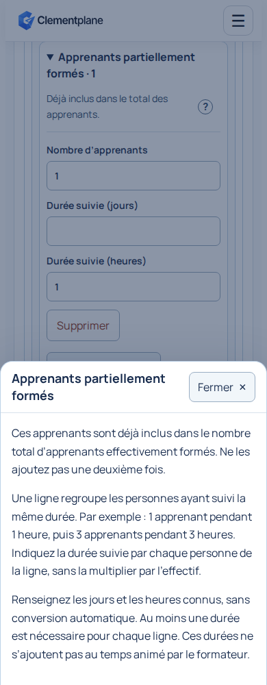

# Aide à la saisie du bilan

Les intitulés et unités restent affichés, ainsi que les mentions « Privé — vous uniquement » et « Visible par l’OF commanditaire ». Touchez le bouton « ? » à côté d’une rubrique pour retrouver toutes ses explications.

Sur mobile, l’aide s’ouvre en bas de l’écran. Son texte défile si nécessaire et le bouton « Fermer » reste accessible. Sur ordinateur, une fenêtre centrée propose la même aide ; la touche Échap la ferme. La saisie en cours reste conservée.

Dépliez « Apprenants partiellement formés » pour accéder à ses lignes et à son aide. Ces personnes restent incluses dans le total. Utilisez « Enregistrer le bilan » pour sauvegarder, puis attendez « Bilan enregistré. ». Ouvrir une aide n’enregistre ni ne modifie le bilan.

## Aperçus mobiles

Captures du vrai composant en recette automatisée, avec données fictives uniquement.

[Formulaire compact](assets/bilan-mobile.png) · [Aide ouverte](assets/aide-mobile.png)

